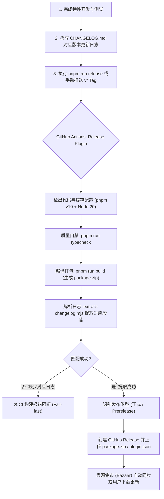

# 自动化发版与 CHANGELOG 维护指南

本文档详细介绍了 **源时记（siyuan-time-spent）** 插件的自动化发布工作流、版本更新日志（CHANGELOG.md）的写作规范、本地发版脚本的使用方法以及 GitHub Actions 自动化流水线的配置和常见问题排障。

---

## 一、自动化发版工作流概述

为了提高发布效率并保障思源笔记插件发布的稳定性和规范性，本项目配置了基于 **GitHub Actions** 的自动化发布流水线：



### 核心特性
1. **严格版本对齐与质量门禁**：在生成发布包前强制执行 `pnpm run typecheck`，避免带病发布。
2. **自动提取更新日志**：根据触发的 Tag 标签（如 `v0.9.0`），自动从 [CHANGELOG.md](file:///D:/MyCodingProjects/siyuan-time-spent/CHANGELOG.md) 中切片提取该版本正文，作为 GitHub Release 的 Release Notes。
3. **缺失阻断（Fail-fast）保障**：若未在 [CHANGELOG.md](file:///D:/MyCodingProjects/siyuan-time-spent/CHANGELOG.md) 中撰写对应版本日志，流水线会主动报错阻断，防止空日志或不规范日志流入生产。
4. **智能预发布识别**：标签中包含 `-alpha`、`-beta`、`-rc` 时自动标识为预发布（Prerelease），常规语义化版本号自动标记为正式 Release。
5. **完整附件上传**：自动打包上传 [package.zip](file:///D:/MyCodingProjects/siyuan-time-spent/package.zip)（供思源集市及用户下载安装）与 [plugin.json](file:///D:/MyCodingProjects/siyuan-time-spent/plugin.json)（供元信息探测）。
6. **单一权威包管理器保障**：全面统一切换至 `pnpm`（通过 [pnpm-lock.yaml](file:///D:/MyCodingProjects/siyuan-time-spent/pnpm-lock.yaml) 锁定），移除遗留的 `package-lock.json`，并通过 `preinstall` 钩子拦截误用 `npm`，从根源杜绝依赖版本漂移。

---

## 二、CHANGELOG.md 写作规范

CHANGELOG 是用户与开发者了解版本演进的核心载体。本项目遵循行业标准的 **[Keep a Changelog](https://keepachangelog.com/zh-CN/1.1.0/)** 规范。

### 2.1 标题格式约定

版本更新记录必须使用 **二级 Markdown 标题（`##`）**，且标题包含版本号与发布日期：

```markdown
## [vX.Y.Z] - YYYY-MM-DD
```

- **版本号声明**：推荐书写为 `## [v0.9.0] - 2026-10-13`（或 `## [0.9.0] - 2026-10-13`）。
- **流水线解析规则**：提取脚本会优先识别括号内的版本号，或识别二级标题中以 `v` 开头的版本字符串；只要主版本号与 Tag 一致即可精准切片。
- **日期格式**：统一采用 ISO 8601 格式 `YYYY-MM-DD`（如 `2026-10-13`）。

### 2.2 更新分类标签

每个版本正文推荐使用 **三级标题（`###`）** 对变更条目进行归类，常用标签包括：

| 分类标题 | 英文对应 | 适用范围说明 |
| :--- | :--- | :--- |
| `### 新增` | `Added` | 新增功能、新看板视图、新交互组件或新配置项 |
| `### 改进` | `Changed` | 现有功能的调整、UI/UX 样式升级、交互流程体验优化 |
| `### 修复` | `Fixed` | 缺陷修复、异常排查、闪退或数据统计误差修正 |
| `### 优化` | `Performance` | 渲染性能提升、降低内存占用、减少不必要的事件监听 |
| `### 废弃` | `Deprecated` | 即将在未来版本中移除的功能或过时的配置属性 |
| `### 移除` | `Removed` | 在本版本中已被正式废弃并移除的旧功能 |
| `### 安全` | `Security` | 漏洞修复或隐私安全策略增强 |

### 2.3 书写范例

```markdown
# 源时记 更新日志

## [v0.9.0] - 2026-09-27

### 新增

1. 番茄钟
   - **沉浸式专注体验**：简洁美观的界面，支持倒计时、正计时、自定义计时功能；
   - **正统番茄工作法节奏**：自动关联当前专注文档，每完成一轮专注自动进入休息；
   - **状态栏胶囊走时**：底部状态栏常驻轻量计时胶囊，实时显示当前计时进展；

2. 日历看板
   - **年度热力图**：新增 GitHub 风格年度专注热力图，支持点击单日精准下钻；
   - **投入分布**：支持按笔记本、标签聚合统计数据；

### 改进

- **UI/UX 视觉重构**：调整 UI 配色与文字卡片样式，无缝适配思源暗色与亮色主题；
- **短会话过滤**：新增浏览阈值下限设置（默认 5 秒），过滤快速翻阅产生的零碎记录；

### 修复

- **指针归零问题**：修复表盘指针在每次打开弹窗时偶发归零的缺陷；

## [v0.8.0] - 2026-09-20

...
```

### 2.4 本地提取测试验证

在推送 Tag 前，可以使用内置脚本在本地快速验证当前版本的 CHANGELOG 能否被正确解析：

```bash
# 验证提取 v0.9.0 的更新日志并直接打印在控制台
pnpm run changelog:extract v0.9.0

# 验证提取并输出至临时文件
pnpm run changelog:extract v0.9.0 --out test_notes.md
```

> [!TIP]
> 如果脚本报错 `未找到版本 [vX.Y.Z] 的更新日志`，请检查 `CHANGELOG.md` 中对应的二级标题格式是否严格对齐 `## [vX.Y.Z] - YYYY-MM-DD`。

---

## 三、操作步骤指南

### 方式一：使用内置交互式脚本发版（推荐）

项目在根目录下提供了经过专门优化的 [release.js](file:///D:/MyCodingProjects/siyuan-time-spent/release.js) 辅助脚本，集成了版本计算、CHANGELOG 预检、文件版本同步、规范 Git Commit 与自动打 Tag 推送。

#### 第 1 步：确认本地工作区干净且代码已通过质检
在准备发版前，先在本地执行测试和类型检查：
```bash
pnpm run typecheck
```

#### 第 2 步：在 CHANGELOG.md 中编写即将发布的版本日志
打开 [CHANGELOG.md](file:///D:/MyCodingProjects/siyuan-time-spent/CHANGELOG.md)，在最顶部添加新版本内容，例如：
```markdown
## [v0.9.1] - 2026-10-13

### 修复
- 修复某某边界条件下的走时异常问题；
```

#### 第 3 步：运行发版脚本（CHANGELOG 驱动自动同步）
```bash
# 推荐：一键发版（自动读取 CHANGELOG.md 顶部新版本，回车确认即可全自动同步）
pnpm run release

# 或免交互直发模式（直接按 CHANGELOG.md 最新版本号发布）：
pnpm run release:changelog

# 传统模式（手动指定递增级别）：
pnpm run release:patch  # 适合 Bug 修复，版本号 +0.0.1
pnpm run release:minor  # 适合特性新增，版本号 +0.1.0
pnpm run release:major  # 适合大版本重构，版本号 +1.0.0
```

脚本将自动执行以下保护与操作：
1. **自动感知与同步版本号**：脚本优先从 `CHANGELOG.md` 顶部解析最新版本号（如 `0.9.1`），回车确认后**自动同步更新 [plugin.json](file:///D:/MyCodingProjects/siyuan-time-spent/plugin.json) 和 [package.json](file:///D:/MyCodingProjects/siyuan-time-spent/package.json) 中的 `version` 字段**，实现以 CHANGELOG 为单一数据源（Single Source of Truth）。
2. **自动预检 CHANGELOG**：若检测到 `CHANGELOG.md` 中尚未撰写该版本的日志，脚本会立即弹出黄色警告并提示是否取消，防止推送后 CI 报错。
3. **规范提交代码**：自动生成符合项目 Git Commit 规范的提交信息（例如 `chore(release): 升级版本至 v0.9.1`），并将 `plugin.json`、`package.json` 及 `CHANGELOG.md` 一并提交。
4. **创建并推送 Tag**：自动在当前 Commit 上打上 `v0.9.1` 标签并推送到 GitHub 远程仓库（`git push origin v0.9.1`）。

#### 第 4 步：前往 GitHub 确认 Release 结果
Tag 推送后，GitHub Actions 工作流将自动触发。访问仓库的 **Actions** 标签页，几分钟后即可在 **Releases** 页面看到带有完整更新日志和附件的发布版本。

---

### 方式二：纯手动命令行打 Tag 发版

若你更偏好纯手动控制版本号与 Git 流程，请遵循以下标准流程：

#### 第 1 步：手动修改版本文件
1. 修改 [package.json](file:///D:/MyCodingProjects/siyuan-time-spent/package.json) 中的 `"version": "X.Y.Z"`；
2. 修改 [plugin.json](file:///D:/MyCodingProjects/siyuan-time-spent/plugin.json) 中的 `"version": "X.Y.Z"`；
3. 在 [CHANGELOG.md](file:///D:/MyCodingProjects/siyuan-time-spent/CHANGELOG.md) 顶部新增 `## [vX.Y.Z] - YYYY-MM-DD` 及其更新条目。

#### 第 2 步：提交变更
遵循项目的 Commit 规范提交版本更新：
```bash
git add package.json plugin.json CHANGELOG.md
git commit -m "chore(release): 升级版本至 vX.Y.Z"
git push origin main
```

#### 第 3 步：打 Tag 并推送到远程
```bash
# Tag 名称务必以小写字母 v 开头
git tag vX.Y.Z
git push origin vX.Y.Z
```

---

## 四、GitHub Actions 自动化流水线配置

自动化工作流配置文件位于 [.github/workflows/release.yml](file:///D:/MyCodingProjects/siyuan-time-spent/.github/workflows/release.yml)。

### 4.1 配置文件核心结构说明

```yaml
name: Create Release on Tag Push

on:
  push:
    tags:
      - "v*" # 仅匹配以 v 开头的版本 Tag（如 v1.0.0）

permissions:
  contents: write # 必须声明写权限，用于在 GitHub 创建 Release 与上传附件

jobs:
  release:
    name: Build and Release Plugin
    runs-on: ubuntu-latest
    steps:
      - name: Checkout Repository
        uses: actions/checkout@v4
        with:
          fetch-depth: 0

      - name: Install pnpm
        uses: pnpm/action-setup@v4
        with:
          run_install: false

      - name: Setup Node.js
        uses: actions/setup-node@v4
        with:
          node-version: 20
          cache: "pnpm"

      - name: Install dependencies
        run: pnpm install --frozen-lockfile

      - name: Typecheck
        run: pnpm run typecheck

      - name: Build plugin package
        run: pnpm run build

      - name: Extract Release Notes from CHANGELOG.md
        id: extract_notes
        run: |
          node scripts/extract-changelog.mjs "${{ github.ref_name }}" --out RELEASE_NOTES.md

      - name: Determine Prerelease
        id: check_prerelease
        shell: bash
        run: |
          TAG="${{ github.ref_name }}"
          if [[ "$TAG" =~ -(alpha|beta|rc) ]]; then
            echo "is_prerelease=true" >> $GITHUB_OUTPUT
          else
            echo "is_prerelease=false" >> $GITHUB_OUTPUT
          fi

      - name: Publish GitHub Release
        uses: softprops/action-gh-release@v2
        with:
          name: Release ${{ github.ref_name }}
          body_path: RELEASE_NOTES.md
          prerelease: ${{ steps.check_prerelease.outputs.is_prerelease == 'true' }}
          draft: false
          files: |
            package.zip
            plugin.json
        env:
          GITHUB_TOKEN: ${{ secrets.GITHUB_TOKEN }}
```

### 4.2 GitHub 仓库权限配置（重要）

GitHub 默认针对新仓库的 `GITHUB_TOKEN` 可能限制为只读（Read only）。为了让 GitHub Actions 顺利创建 Release，必须确保仓库开启了写入权限：

1. 打开 GitHub 仓库页面，点击 **Settings**（设置）；
2. 在左侧侧边栏中选择 **Actions** -> **General**；
3. 向下滚动至 **Workflow permissions** 模块；
4. 勾选 **Read and write permissions**（读写权限）；
5. 点击 **Save** 保存。

> [!IMPORTANT]
> 若未开启读写权限，Actions 执行至 `Publish GitHub Release` 步骤时将抛出 `403 Resource not accessible by integration` 错误。

---

## 五、思源集市（Bazaar）上架与更新机制

根据思源官方集市规范（参考 [调试与发布流程.md](file:///D:/MyCodingProjects/siyuan-time-spent/developer_docs/06-guides/%E8%B0%83%E8%AF%95%E4%B8%8E%E5%8F%91%E5%B8%83%E6%B5%81%E7%A8%8B.md)）：

1. **首次发布登记**：
   - Fork 官方集市仓库 `siyuan-note/bazaar`；
   - 在其 `plugins.json` 中登记本项目仓库信息；
   - 向官方提交 Pull Request 并等待审核合并。
2. **日常版本迭代更新**：
   - 官方集市机器人会定期探测已登记插件的 GitHub Releases；
   - 每次打 Tag 并在 GitHub Release 中上传最新的 [package.zip](file:///D:/MyCodingProjects/siyuan-time-spent/package.zip) 后，思源笔记集市将**自动同步**最新版本，开发者无需重复提交 PR。

---

## 六、常见问题排障（FAQ）

### Q1: GitHub Actions 构建因 `未找到版本 [vX.Y.Z] 的更新日志` 报错失败？
**原因**：[CHANGELOG.md](file:///D:/MyCodingProjects/siyuan-time-spent/CHANGELOG.md) 中缺少对应版本的二级标题，或者版本号存在手误拼写（如 Tag 为 `v0.9.1` 但 CHANGELOG 里写成了 `## [v0.9.0]`）。  
**解决方式**：
1. 本地打开 [CHANGELOG.md](file:///D:/MyCodingProjects/siyuan-time-spent/CHANGELOG.md)，补充正确的 `## [vX.Y.Z] - YYYY-MM-DD` 及其内容；
2. 提交代码并推送：`git commit -am "docs(changelog): 补充 vX.Y.Z 发版日志" && git push`；
3. 重新打 Tag 或在 GitHub Release 页面触发重跑。

### Q2: 误打了错误的 Tag，如何撤回并重新发版？
若本地或远程推送了错误的 Tag（例如 `v0.9.9`）：
```bash
# 1. 删除本地 Tag
git tag -d v0.9.9

# 2. 删除远程仓库的 Tag
git push origin :refs/tags/v0.9.9
```
随后前往 GitHub 仓库的 Releases 页面，删除对应的 Release 草稿或记录即可。

### Q3: 本地执行 `pnpm run release` 提示 `Working tree has uncommitted changes`？
发版脚本会把所有改动打包并打 Tag，推荐在工作区干净的状态下执行发版操作。请先将未完成的代码 commit 或通过 `git stash` 暂存后再执行发版。
